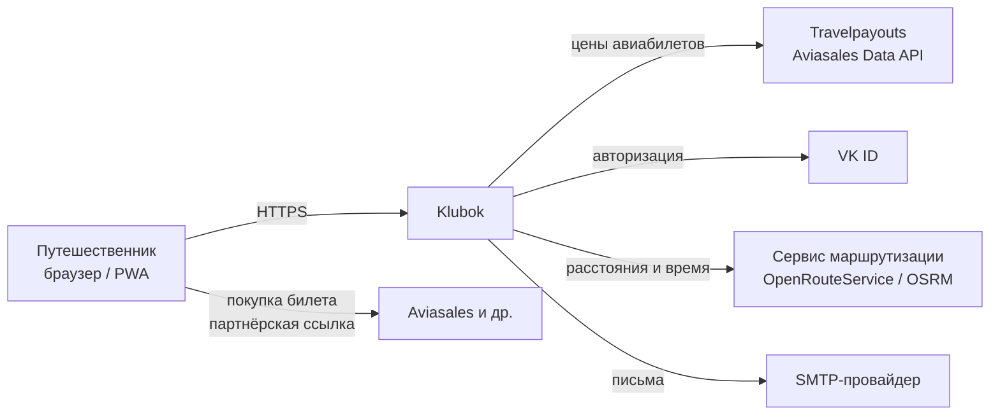
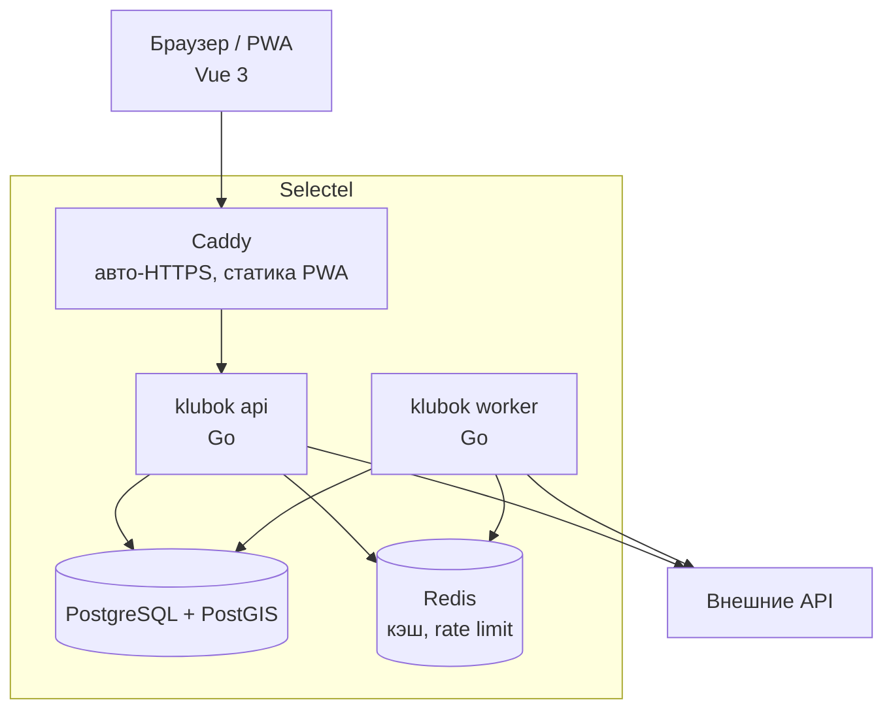
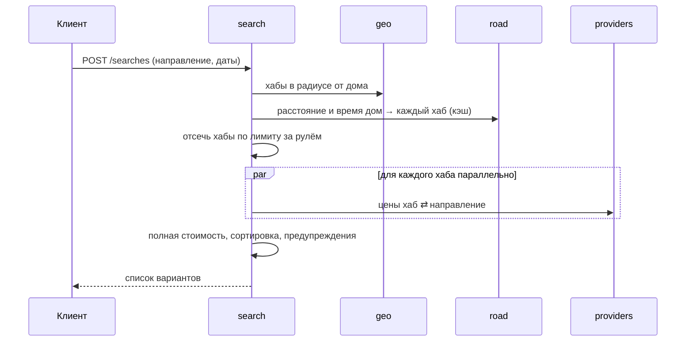

# 4. Архитектура

## 4.1. Общий подход

**Модульный монолит** на Go ([ADR-0003](adr/0003-modular-monolith.md)): одно приложение и один деплой, но код разделён на модули с явными границами. Модули общаются через Go-интерфейсы, не лезут в таблицы друг друга. Это позволит при необходимости вынести тяжёлый модуль (поиск, сборщик цен) в отдельный сервис без переписывания.

Один бинарник запускается в двух ролях:
- `klubok api` — HTTP API;
- `klubok worker` — фоновые задачи (обновление цен, справочников, рассылка писем).

## 4.2. Контекст системы (C4: уровень 1)



## 4.3. Контейнеры (C4: уровень 2)



## 4.4. Модули бэкенда

| Модуль | Ответственность | MVP |
|---|---|---|
| `auth` | Регистрация, вход, VK ID, сессии и refresh-токены, восстановление пароля | ✅ |
| `profile` | Настройки пользователя (город, машина, путешественники) | ✅ |
| `geo` | Справочник точек (города, аэропорты; позже вокзалы), поиск в радиусе через PostGIS, автодополнение | ✅ |
| `road` | Расстояние и время на машине между точками, кэш расстояний, платные дороги | ✅ |
| `fuel` | Цены на топливо по регионам и типам | ✅ (упрощённо) |
| `providers` | Адаптеры к внешним источникам цен: `travelpayouts`, позже поезда и автобусы. Единый интерфейс `FareProvider` | ✅ |
| `search` | Оркестрация поиска: подбор хабов, параллельный запрос цен, расчёт стоимости, ранжирование | ✅ |
| `deals` | История цен, базовая цена, горячие предложения | v2 |
| `notify` | Письма, позже push и уведомления о ценах | ✅ (письма) |
| `ugc` | Фото, посты, отзывы | v4+ |

Ключевой интерфейс — источник цен:

```go
type FareProvider interface {
    // RoundTrip возвращает котировки туда-обратно между двумя точками на заданные даты.
    RoundTrip(ctx context.Context, q RoundTripQuery) ([]Quote, error)
    Name() string
}
```

## 4.5. Поток поиска (MVP)



Запросы к источникам идут параллельно с общим таймаутом (по умолчанию 10 с); если источник не ответил, варианты собираются из ответивших, а клиент получает предупреждение.

## 4.6. Фронтенд

- Vue 3 + TypeScript + Vite, Pinia, Vue Router.
- PWA: `vite-plugin-pwa` (манифест, service worker, установка на телефон, позже push).
- Тема — только светлая, тёплая: кремовый фон, тёплые нейтральные, терракотовый акцент (`#b6522d`); токены — в `frontend/src/style.css`. Тёмной темы нет и от системной настройки она не включается.
- UI: Tailwind CSS + **shadcn-vue** (компоненты на Reka UI), иконки Lucide ([ADR-0010](adr/0010-ui-tailwind-shadcn-vue.md)).
- Карты: мини-карта маршрута — Leaflet + растровые тайлы OSM ([ADR-0012](adr/0012-trip-map.md)); большая карта направлений (v2+) — MapLibre GL.
- Клиент API: типы генерируются из OpenAPI (`openapi-typescript`, `npm run gen:api`), запросы — `openapi-fetch`.
- Шрифт Inter хранится в проекте (`@fontsource-variable/inter`), без внешних CDN.
- Гостевой профиль — Pinia + localStorage.

## 4.7. Структура репозитория

```
klubok/
├── backend/
│   ├── cmd/klubok/            # main: команды api, worker, migrate
│   ├── internal/
│   │   ├── auth/
│   │   ├── profile/
│   │   ├── geo/
│   │   ├── road/
│   │   ├── fuel/
│   │   ├── providers/
│   │   │   └── travelpayouts/
│   │   ├── search/
│   │   └── platform/          # конфиг, БД, логирование, http-сервер, ошибки
│   ├── migrations/
│   └── go.mod
├── frontend/                  # Vue 3 PWA
├── api/openapi.yaml           # контракт API (spec-first)
├── deploy/                    # docker-compose, nginx, конфиги окружений
└── docs/
```

## 4.8. Библиотеки бэкенда (предложение)

| Задача | Выбор |
|---|---|
| HTTP-роутер | `chi` |
| Генерация сервера из OpenAPI | `oapi-codegen` |
| Работа с БД | `pgx` + `sqlc` (типобезопасный SQL без ORM) |
| Миграции | `goose` |
| Логирование | `log/slog` (стандартная библиотека) |
| Хэширование паролей | `argon2id` (`golang.org/x/crypto`) |
| JWT | `golang-jwt/jwt` |
| Тесты с БД | `testcontainers-go` |

## 4.9. Окружения

| Окружение | Где | Назначение |
|---|---|---|
| local | docker-compose на машине разработчика | Разработка |
| prod | Selectel | Боевое |

Staging добавим, когда появятся внешние пользователи.
