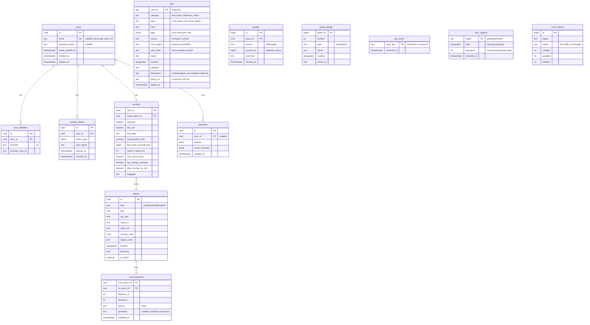

# 5. Модель данных

СУБД: PostgreSQL + PostGIS. Идентификаторы — UUID v7 (сортируемые по времени). Деньги — целые копейки (`bigint`), валюта — RUB. Время — `timestamptz` в UTC.

## 5.1. Схема (MVP)

## 5.2. Справочные таблицы

**`fuel_prices`** — цены на топливо.

| Поле | Тип | Примечание |
|---|---|---|
| country_code | char(2) | Страна |
| region_code | text | Код региона (ISO 3166-2, например `RU-SAM`); пустая строка — цена по стране |
| fuel_type | text | `ai92`, `ai95`, `dt`, `lpg` |
| price_kop | bigint | |
| updated_at | timestamptz | |

**`hub_costs`** — расходы на хабе.

| Поле | Тип | Примечание |
|---|---|---|
| place_id | uuid | Аэропорт / вокзал |
| parking_per_day_kop | bigint | Стоимость парковки в сутки |
| source | text | Ручной ввод / источник |
| updated_at | timestamptz | |

**`border_rules`** — правила пересечения границы на машине: `from_country`, `to_country`, страховка (`insurance_kop` за поездку), `crossing_hours` (ориентировочное время на КПП), `note` (текст предупреждения).

## 5.3. Цены (v2)

**`price_quotes`** — история котировок для горячих предложений.

| Поле | Тип |
|---|---|
| origin_iata, destination_iata | text |
| depart_date, return_date | date |
| price_kop | bigint |
| transfers | smallint |
| airline | text |
| source | text |
| found_at | timestamptz (момент, когда источник нашёл цену) |
| fetched_at | timestamptz (момент, когда мы её получили) |

Индекс: `(origin_iata, destination_iata, fetched_at)`. Хранение — 12 месяцев, далее агрегаты по неделям.

## 5.4. Кэш (Redis)

| Ключ | TTL | Содержимое |
|---|---|---|
| `fare:{provider}:{origin}:{dest}:{dep}:{ret}` | 1 ч | Ответ источника |
| `rl:{ip}` / `rl:user:{id}` | 1 мин | Ограничение частоты запросов |

Расстояния по дороге кэшируются в PostgreSQL (`road_distances`) бессрочно: они почти не меняются, а набор пар «дом → хаб» ограничен.

## 5.5. Загрузка справочника точек

- Города и аэропорты: открытые данные Travelpayouts (`cities.json`, `airports.json`) — совпадают по кодам с ценами `[сверить]`; координаты при необходимости дополняются из OurAirports.
- Ж/д вокзалы и автостанции (v3): `[открыто]`, зависит от источника цен на поезда/автобусы.
- Регион (`region_code`) нужен для цены топлива; определяется по координатам.

## 5.6. Сессии и избранное

Решение — [ADR-0018](adr/0018-favorites.md).

**`sessions`** — анонимные сессии (cookie `klubok_sid`).

| Поле | Тип | Примечание |
|---|---|---|
| id | uuid | Значение cookie |
| user_id | uuid | Пусто до авторизации |
| created_at, last_seen_at | timestamptz | Визит отмечается не чаще раза в сутки |

**`favorites`** — избранные маршруты.

| Поле | Тип | Примечание |
|---|---|---|
| id | uuid | |
| session_id | uuid | Владелец до авторизации |
| user_id | uuid | Проставляется после авторизации |
| kind | text | `trip`; позже — отели, места |
| title | text | «Самара → Алматы, ноябрь 2026 г.» |
| params | jsonb | Параметры поиска в формате `GET /trips` |
| pick | jsonb | `{kind: flight, hub_iata, depart_date, return_date}` или `{kind: drive}` |
| snapshot | jsonb | Цена и детали на момент сохранения |
| fingerprint | text | Уникален среди неудалённых в сессии — без дублей |
| note | text | Заметка (задел под «блокнот») |
| created_at, deleted_at | timestamptz | Удаление мягкое |

**`trip_items`** — путевой лист: пункты сохранённой поездки ([ADR-0019](adr/0019-trip-sheet.md)).

| Поле | Тип | Примечание |
|---|---|---|
| id | uuid | |
| favorite_id | uuid | Поездка из `favorites`; удаляется вместе с ней |
| stage | text | Этап: `prep`, `road`, `flight`, `stay`, `see` (что посмотреть), `place` (аренда и услуги на месте), `return`, `home` |
| kind | text | `note` — заметка/дело, `link` — страница на чужом сайте, `place` — место по пути или на месте |
| title | text | |
| url | text | Для `link` и мест из путеводителя |
| price | bigint | Копейки; вводит пользователь, идёт в общий бюджет |
| lat, lon | double precision | Где место (из лент мест); для карты и дороги через места по пути |
| image_url, description | text | Превью ссылки со страницы объявления (og-теги) |
| city | text | Город-остановка по пути (id Wikidata, как в `via`): жильё и дела в нём; пусто — место назначения или дорога ([ADR-0023](adr/0023-stops-along-the-road.md)) |
| done | boolean | «Сделано»; у ссылок — «выбрано», только тогда цена идёт в итог |
| created_at | timestamptz | Порядок в этапе |

