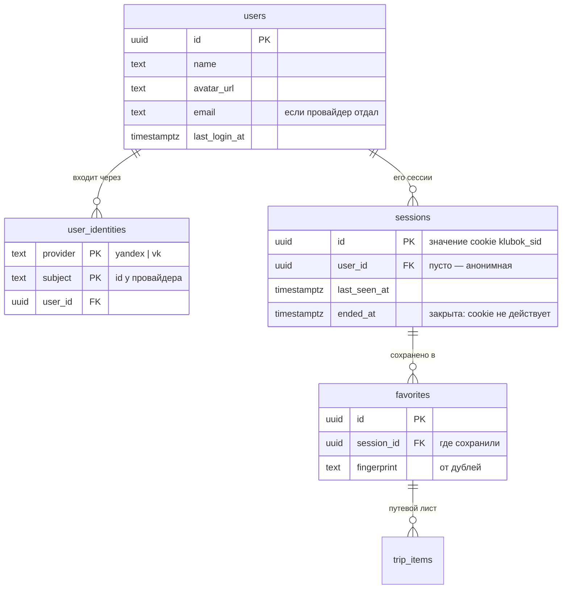
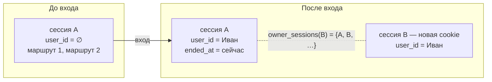

# 12. Вход и учётные записи

Решение — [ADR-0026](adr/0026-login-yandex-vk.md). Документ объясняет, как устроен вход, где что хранится и почему маршруты, сохранённые до входа, не теряются.

## 12.1. Коротко

- Входим только через **Яндекс ID** и **VK ID**. Паролей, писем с подтверждением и восстановления у нас нет.
- Пользователя на сайте определяет **сессия**: cookie `klubok_sid` со случайным UUID. Она же была и до авторизации, мы её не заменяли, а дополнили.
- Сессия бывает **анонимной** (`user_id` пуст) или **вошедшей** (`user_id` заполнен). JWT и refresh-токены не нужны: сессия хранится в БД, cookie — `HttpOnly`, у JavaScript к нему доступа нет.
- Данные (избранное, путевой лист) пишутся в **текущую сессию**. Читаются из всех сессий владельца: у анонима это одна сессия, у вошедшего — все сессии его пользователя. Поэтому при входе ничего не переносится, а только привязывается.

## 12.2. Где что хранится

| Что | Где | Сколько живёт |
|---|---|---|
| Сессия | cookie `klubok_sid` (HttpOnly, SameSite=Lax, Secure на HTTPS) → строка `sessions` | 400 дней, продлевается при каждом визите; закрывается выходом |
| Незаконченный вход: `state`, `code_verifier` PKCE, куда вернуть | cookie `klubok_oauth` (HttpOnly, SameSite=Lax, путь `/api/v1/auth`), в БД и Redis не пишется | 10 минут, стирается на обратном редиректе |
| Пользователь: имя, фото, почта | `users` | пока не удалят |
| Чем входит: `yandex` / `vk` + id у провайдера | `user_identities`, ключ `(provider, subject)` | вместе с пользователем |
| Избранное | `favorites.session_id` → `sessions` | мягкое удаление |
| Путевой лист | `trip_items.favorite_id` → `favorites` | вместе с поездкой |
| Токены Яндекса и VK | **нигде** | нужны один раз: получить профиль при входе |
| Гостевой профиль (дом, люди, машина) | `localStorage` браузера | пока не очистят; перенос в аккаунт — следующий шаг |



## 12.3. Как пользователь входит

```mermaid
sequenceDiagram
    autonumber
    actor U as Браузер
    participant K as Klubok API
    participant P as Яндекс ID / VK ID
    participant DB as PostgreSQL

    U->>K: GET /api/v1/auth/yandex/start?return=/favorites
    K-->>U: 302 на P + cookie klubok_oauth {state, verifier, return}
    U->>P: страница входа, «Разрешить»
    P-->>U: 302 на /api/v1/auth/yandex/callback?code&state
    U->>K: callback + cookie klubok_oauth + cookie klubok_sid (анонимная)
    K->>K: state из адреса = state из cookie? (иначе — отказ)
    K->>P: код + code_verifier → access token → профиль
    K->>DB: user_identities (yandex, id) → пользователь (нет — завести)
    K->>DB: новая сессия с user_id; анонимная: user_id = он, ended_at = now()
    K->>DB: убрать копии маршрутов, которые у него уже были
    K-->>U: 302 на /favorites + новая cookie klubok_sid
    U->>K: GET /api/v1/me → имя и фото в шапке
```

Шаги подробнее:

1. **Кнопка.** «Войти» в шапке открывает лист с кнопками провайдеров. Список кнопок — из `GET /me` (`providers`): провайдер без ключей на сервере не показывается. Кнопка — обычная ссылка на `/api/v1/auth/{provider}/start?return=<текущая страница>`.
2. **Start.** Сервер генерирует `state` и `code_verifier` (по 32 случайных байта) и кладёт их вместе с `return` в cookie `klubok_oauth`. В адрес провайдера уходит `code_challenge = SHA-256(verifier)`.
3. **Провайдер** спрашивает разрешение и возвращает браузер на `/api/v1/auth/{provider}/callback` с `code` и тем же `state`. VK добавляет `device_id`, он нужен при обмене кода.
4. **Проверка.** `state` из адреса должен совпасть со `state` из cookie этого браузера. Так никто не сможет подсунуть свой код по ссылке и тихо залогинить человека в чужой аккаунт (login CSRF). Cookie сразу стирается, повторить тот же callback нельзя.
5. **Обмен кода.** Код вместе с `code_verifier` меняется на access token. Яндекс: `oauth.yandex.ru/token` с `client_secret`, профиль — `login.yandex.ru/info`. VK: `id.vk.com/oauth2/auth`, клиент публичный, без секрета, профиль — `id.vk.com/oauth2/user_info`. Токен после этого выбрасываем.
6. **Пользователь.** Ищем `(provider, subject)` в `user_identities`. Нашли — обновляем фото и время входа. Не нашли — заводим `users` и `user_identities` в одной транзакции. Если два первых входа пришли одновременно (двойной клик), второй упрётся в ключ и повторит поиск.
7. **Сессия.** Подробно — следующий раздел.
8. **Возврат** на `return`. Принимается только путь на нашем сайте: `//evil.ru`, полный адрес и `/api/...` превращаются в `/`, чтобы вход нельзя было использовать как открытый редирект.

**Ошибки.** Пользователь нажал «Отмена» у провайдера (`error=access_denied`) — возвращаем его на страницу, откуда он пришёл, молча. Любая другая ошибка (не тот `state`, провайдер не ответил, БД) — возвращаем на ту же страницу с `?login=failed`: фронтенд снова откроет лист входа с сообщением и уберёт метку из адреса. Подробности — в логе `login failed`.

## 12.4. Как не теряются маршруты: до входа и после

### Владелец данных

Каждый запрос к избранному и путевому листу проверяет владельца функцией БД `owner_sessions(сессия)`. Она возвращает:
- саму сессию;
- если у сессии есть `user_id` — все сессии этого пользователя: открытые на других устройствах, закрытые после выхода и бывшие анонимные.

```sql
WHERE f.session_id IN (SELECT owner_sessions(@session_id))
```

Записи всегда пишутся в текущую сессию, `favorites.session_id` никогда не меняется. Из-за этого в схеме нет второго владельца (`favorites.user_id`), и при входе не нужен перенос данных из одной таблицы в другую. Его можно было бы забыть сделать для новой сущности.

### Что происходит с сессиями при входе



1. Заводится **новая** сессия B с `user_id`, её id уходит в cookie.
2. Прежняя сессия A этого браузера:
   - **анонимная** — получает `user_id` пользователя и закрывается (`ended_at`). Её cookie больше не действует, но маршруты в ней теперь принадлежат пользователю;
   - **уже вошедшая** (вход под другим аккаунтом) — просто закрывается и остаётся за прежним пользователем.
3. Копии: если вариант с тем же отпечатком (`fingerprint`) уже был у пользователя, копия из сессии A мягко удаляется, но только если к ней не начат путевой лист. Иначе остаются обе.

Почему новая сессия, а не та же A с проставленным `user_id`: id сессии до входа мог стать известен постороннему (например, cookie подсунули заранее). Если бы он после входа стал ключом от аккаунта, это была бы атака session fixation. Новый id после входа её закрывает.

### Сценарии

| Что сделал пользователь | Что увидит |
|---|---|
| Сохранил 2 маршрута анонимно, вошёл | Те же 2 маршрута, уже в аккаунте |
| Вошёл на телефоне, потом на ноутбуке, где анонимно сохранил ещё 1 | На обоих устройствах — все 3 |
| На ноутбуке анонимно сохранил то, что уже было в аккаунте | После входа — одна запись (копия без путевого листа убрана) |
| Вошедший сохраняет вариант, который есть с другого устройства | Возвращается существующая запись, дубль не создаётся |
| Вышел | Чистая анонимная сессия, своих маршрутов не видно; при следующем входе всё на месте |
| Очистил браузер до входа | Анонимные маршруты потеряны (cookie был единственным ключом); после входа такого риска нет |
| Вошёл через Яндекс, а потом через VK | Это **два разных** аккаунта: по почте не склеиваем (ниже) |

Сценарии с телефоном, ноутбуком, дублями и выходом проверяет тест `TestLoginKeepsFavorites` ([auth_test.go](../backend/internal/httpapi/auth_test.go)) с фейковым провайдером на настоящей БД (`KLUBOK_TEST_DATABASE_URL`).

### Выход

`POST /api/v1/auth/logout` закрывает текущую сессию (`ended_at`) и стирает cookie. Данные не удаляются и никуда не переносятся: закрытая сессия по-прежнему принадлежит пользователю, поэтому её маршруты вернутся при следующем входе. Другие устройства остаются в аккаунте.

## 12.5. Почему не склеиваем аккаунты по почте

Яндекс и VK могут отдать один и тот же email. Автоматическая склейка по почте — известный способ угнать аккаунт: если у одного из провайдеров почта не подтверждена, человек с чужим адресом получит чужие маршруты. Поэтому способы входа связываются только явно: пользователь вошёл одним способом и в личном кабинете привязывает второй. Это следующий шаг. Таблица `user_identities` к нему готова: у пользователя может быть несколько строк.

## 12.6. API

| Метод | Путь | Что делает |
|---|---|---|
| GET | `/api/v1/me` | `{ user?, providers }`: кто вошёл и какие кнопки входа показывать (в OpenAPI) |
| GET | `/api/v1/auth/{provider}/start?return=/путь` | Начало входа: cookie `klubok_oauth` и редирект на провайдера |
| GET | `/api/v1/auth/{provider}/callback` | Возврат от провайдера: сессия пользователя и редирект на `return` |
| POST | `/api/v1/auth/logout` | Выход, 204 |

`start` и `callback` — переходы браузера, а не вызовы API, поэтому в OpenAPI их нет, только описание в теге `auth`.

## 12.7. Настройка

| Переменная | Что это |
|---|---|
| `KLUBOK_PUBLIC_URL` | Адрес сайта, каким его видит браузер (`http://localhost:5173` в разработке, `https://<домен>` в продакшене). Из него собирается redirect URI `<KLUBOK_PUBLIC_URL>/api/v1/auth/{provider}/callback`; тот же адрес указывается в кабинете провайдера |
| `YANDEX_CLIENT_ID`, `YANDEX_CLIENT_SECRET` | Приложение на oauth.yandex.ru, доступы `login:info`, `login:email`, `login:avatar` |
| `VK_CLIENT_ID` | Приложение VK ID (id.vk.com), тип «Web»; секрет не нужен |

Провайдер без ключей выключен, сервер пишет об этом в лог при старте. В разработке сайт нужно открывать именно по адресу из `KLUBOK_PUBLIC_URL`: cookie `localhost` и `127.0.0.1` разные, и вход, начатый на одном адресе, на другом не завершится.

## 12.8. Безопасность и 152-ФЗ

- Cookie сессии и входа — `HttpOnly` (JavaScript их не читает), `SameSite=Lax` (не уходят с чужих сайтов в POST-запросах, поэтому `logout` и изменение избранного защищены от CSRF), `Secure` за HTTPS.
- Токены провайдеров не храним. Из профиля берём только id, имя, фото и почту.
- Способы входа — российские провайдеры, что соответствует требованиям 149-ФЗ (ст. 10.6) к авторизации пользователей российских сайтов.
- Имя, почта и фото — персональные данные. До запуска нужны политика обработки ПДн, согласие при первом входе и уведомление Роскомнадзора ([09-nfr.md](09-nfr.md)). **[открыто]**

## 12.9. Дальше

- Привязка второго способа входа в личном кабинете (Яндекс + VK у одного пользователя).
- Перенос гостевого профиля (дом, люди, машина) из `localStorage` в аккаунт при первом входе.
- Удаление аккаунта и данных (`DELETE /me`) и «выйти на всех устройствах».
- Вход по номеру телефона (код в SMS или звонок), если аудитории Яндекса и VK не хватит.
- Чистка старых закрытых анонимных сессий без данных (крон).
